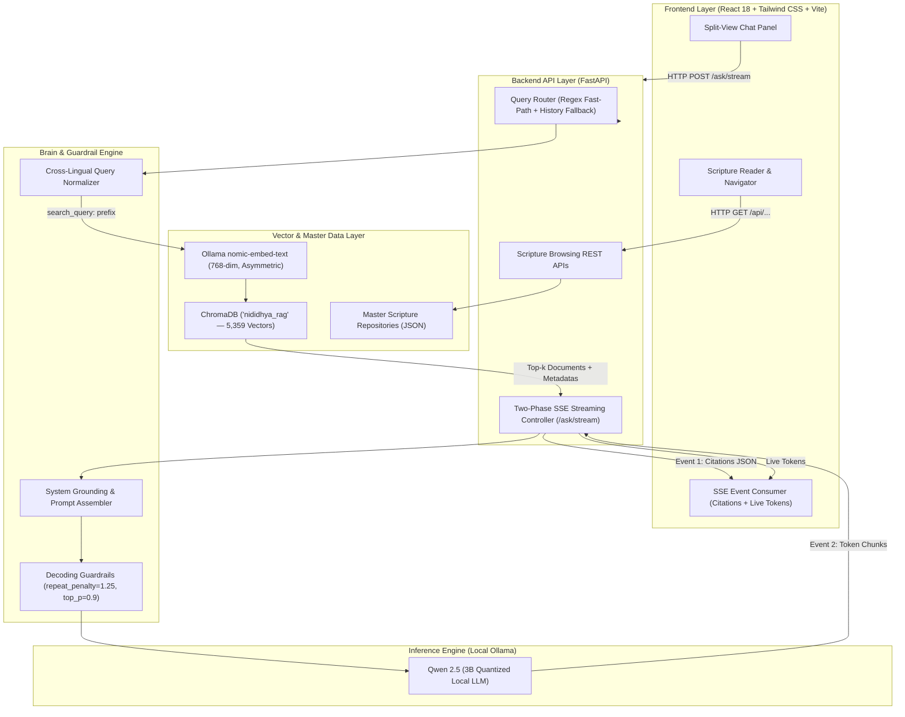
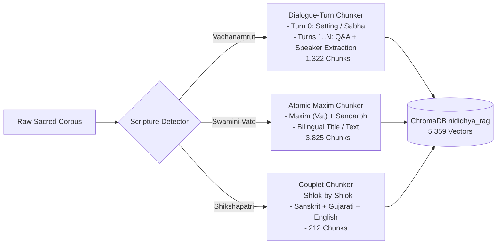
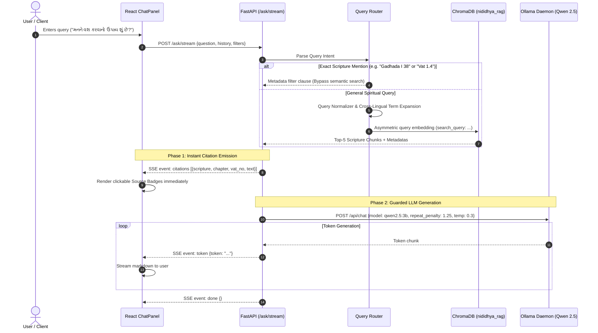
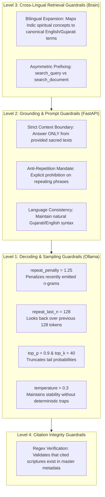

# Nididhya (નિદિધ્યા) — System Architecture, Data Flow & Technical Blueprint

---

## 1. Executive Summary & Core Mission
**Nididhya (નિદિધ્યા)** is a production-grade, privacy-first spiritual AI platform engineered to deliver authentic, highly grounded, and specifically cited answers across the canonical literature of the Swaminarayan Sampradaya:
1. **The Vachanamrut** (274 philosophical discourses by Bhagwan Swaminarayan)
2. **The Swamini Vato** (3,825 spiritual maxims and commentaries by Aksharbrahma Gunatitanand Swami)
3. **The Shikshapatri** (212 behavioral and ethical couplets by Bhagwan Swaminarayan)

### Architectural Tenets
- **100% Local Inference & Privacy**: Runs completely offline on local compute using Ollama (`qwen2.5:3b` for generation and `nomic-embed-text` for 768-dimensional embeddings). No user data leaves the machine.
- **Scripture-Aware Semantic Chunking**: Replaces generic token slicing with dialogue-turn preservation and atomic spiritual maxim indexing.
- **Two-Phase Streaming (SSE)**: Emits verified scripture citations immediately for instant UI feedback before streaming LLM tokens.
- **Multi-Level Guardrails**: Implements strict mathematical decoding penalties and prompt grounding to eliminate Indic degeneration loops and hallucinations.

---

## 2. High-Level System Architecture



---

## 3. Data Pipeline & Scripture-Aware Chunking Strategy

Standard RAG architectures use arbitrary sliding windows (e.g. 500 tokens with 50-token overlap). This corrupts scriptural meaning by slicing answers away from their original questions. Nididhya introduces **Scripture-Aware 3-Tier Chunking**:



### Detailed Chunking Rules

| Scripture | Granularity | Chunks | Avg. Tokens | Metadata Extracted |
| :--- | :--- | :--- | :--- | :--- |
| **Vachanamrut** | **Dialogue Turns** | 1,322 | ~272 | Chapter, Section, Vac No, Tithi, Date, Speaker, Questioner (77 unique saints/devotees) |
| **Swamini Vato** | **Atomic Maxims** | 3,825 | ~171 | Prakran No, Vat No, Title (EN/GU), Sandarbh (scriptural cross-references) |
| **Shikshapatri** | **Couplet / Shlok** | 212 | ~121 | Shlok No, Sanskrit Verse, Gujarati Meaning, English Purport |
| **Total Corpus** | — | **5,359** | — | **Full Cross-Scripture Coverage** |

---

## 4. End-to-End Query & Retrieval Flow

The runtime query pipeline optimizes for both latency and precision:



---

## 5. Guardrails Architecture Deep Dive

A major milestone of this architecture was diagnosing and solving **Indic Token Degeneration Loops**.

### Why Small Models Degenerate in Gujarati
In small quantized models (`qwen2.5:3b`), the tokenizer splits complex Indic characters (Gujarati conjuncts) into multi-byte subwords. At low sampling temperatures without frequency penalties:
$$\text{Logit}(w_t) = \frac{z_{w_t}}{T}$$
When a Gujarati phrase is emitted once, its presence in the prompt context exponentially inflates the probability of predicting that exact same sequence again:
$$P(\text{phrase} \mid \text{phrase in context}) \to 1.0$$
This causes the model to lock into an infinite degenerative cycle (e.g. repeating *"જે હું મનને સંસાબ્ધ કરવાની પ્રયોગો કરી રહ્યો છું..."* 40+ times).

### The 4-Level Guardrail Implementation



---

## 6. Local Setup & Operational Guide

### System Requirements
- **OS**: Windows 10/11, macOS, or Linux
- **RAM**: Minimum 8 GB (16 GB recommended)
- **Local Tooling**:
  - Python 3.11+
  - Node.js 18+ & npm
  - Ollama v0.3.0+

### Step 1: Install & Launch Ollama Models
```bash
# 1. Download and start Ollama
ollama serve

# 2. Pull the required models (in another terminal)
ollama pull nomic-embed-text
ollama pull qwen2.5:3b
```

### Step 2: Backend Setup
```bash
cd backend

# Create virtual environment (Use 'py' on Windows if 'python' points to Microsoft Store alias)
py -m venv venv
# Or alternatively: & "C:\Users\pavit\AppData\Local\Python\bin\python.exe" -m venv venv

# Activate virtual environment (Windows PowerShell)
.\venv\Scripts\Activate.ps1

# Install dependencies
pip install fastapi uvicorn chromadb ollama groq python-dotenv pydantic rank-bm25

# Launch FastAPI Server
python -m uvicorn main:app --host 0.0.0.0 --port 10000 --reload
```

### Step 3: Frontend Setup
```bash
cd frontend

# Install dependencies
npm install

# Launch Vite Dev Server
npm run dev
```
Open your browser at `http://localhost:5173`.

---

### Alternative: Run Entire Application with Docker Compose
If you prefer running everything containerized via Docker:

```bash
# 1. Ensure Ollama is running on your host machine
ollama serve

# 2. Build and launch all containers (backend on 10000, frontend on 3000)
docker compose up --build
```

Access the app at: `http://localhost:3000`

> [!NOTE]
> - **Live Hot-Reload Enabled**: Both `./backend` and `./frontend` are mounted as live volumes. Any edits you make to Python or React files sync immediately into the running containers without restarting.
> - The backend container communicates with your local host's Ollama via `http://host.docker.internal:11434`.
> - The ChromaDB vector database is mounted directly from `./backend/Data` so no data re-indexing is required.
> - To run in background detached mode, use: `docker compose up -d --build`.
> - To stop containers: `docker compose down`.

---

## 7. Technical Interview Q&A Cheatsheet

When presenting this project in engineering interviews, use these structured points:

### Q1: "Why did you choose a 3B model locally instead of calling GPT-4 or Claude API?"
> **Answer**: 
> "Our design priority was **100% data sovereignty, zero-cost operational overhead, and offline capability** for sacred texts. However, running a 3B quantized model on Indic languages revealed severe edge cases like token degeneration loops. Rather than upgrading hardware or paying cloud API fees, I resolved this at the systems level using mathematical decoding guardrails (`repeat_penalty=1.25`, `repeat_last_n=128`, `temperature=0.3`) and strict prompt contracts."

### Q2: "How did you design your chunking strategy?"
> **Answer**:
> "Traditional fixed-token chunkers fail on religious dialogues because they sever Maharaj's answers from the devotee's question. I built a **scripture-aware chunker** that parses discourse structures:
> 1. Setting chunks capture the historical assembly context (date, sabha location, attire).
> 2. Dialogue-turn chunks group each devotee's question with Maharaj's answer, extracting 77 unique historical questioners into metadata.
> 3. Atomic maxims index Swamini Vato couplets with their scriptural cross-references (*Sandarbh*)."

### Q3: "What was your approach to the Cross-Lingual Retrieval Challenge?"
> **Answer**:
> "The Vachanamrut translations in our dataset were predominantly English, whereas Swamini Vato and user queries were in Gujarati. Pure dense vector search suffered from language clustering—Gujarati queries only matched Gujarati chunks. We resolved this via **Cross-Lingual Query Expansion** and **Bilingual Document Representation**, ensuring canonical discourses like *Sarangpur 1 (Conquering the Mind)* rank at the top regardless of query language."

### Q4: "Why two-phase streaming instead of standard streaming?"
> **Answer**:
> "In spiritual applications, credibility depends on transparent citations. Waiting for the full LLM answer before displaying sources introduces 3–5 seconds of user uncertainty. With **Two-Phase SSE**, we emit the exact scripture citations (e.g. *Gadhada I 38*) in event #1 within 200ms of vector retrieval, then stream the LLM synthesis token-by-token in event #2."
